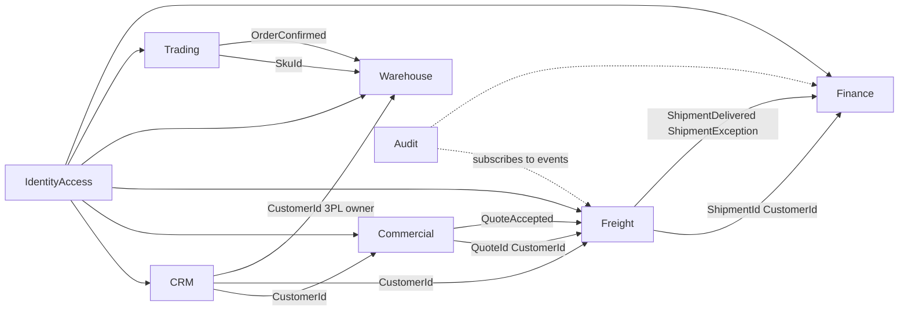

# DDD architecture

This ERP is a **Domain-Driven Design modular monolith**. That is the first architecture decision. Do not start a CRUD-by-table design, a single shared “models” folder, or a microservice split.

Read the domain skill for ubiquitous language. This skill owns boundaries and tactical rules.

Sources: Evans (bounded context, ubiquitous language), [Vernon Effective Aggregate Design](https://kalele.io/wp-content/uploads/2019/01/DDD_COMMUNITY_ESSAY_AGGREGATES_PART_2.pdf) (small aggregates, identity references, eventual consistency), [Microsoft tactical DDD](https://learn.microsoft.com/en-us/azure/architecture/microservices/model/tactical-domain-driven-design), [Microsoft value objects](https://learn.microsoft.com/en-us/dotnet/architecture/microservices/microservice-ddd-cqrs-patterns/implement-value-objects).

## Outcome

Every feature lands in one bounded context, mutates one aggregate per transaction, and talks to other contexts by identity and events.

## Strategic map

One NestJS process, one PostgreSQL database, **eight bounded contexts**. Each context owns its tables. No foreign keys across contexts. No shared Prisma models of another context’s entities.



| Context | Ubiquitous language | Aggregate roots | Owns writes |
| --- | --- | --- | --- |
| IdentityAccess | User, Role, Session, Permission | `User` | users, roles, sessions |
| CRM | Customer, Contact | `Customer` | customers, contacts |
| Commercial | Quote, booking cadence, mode | `Quote` | quotes |
| Freight | Shipment, cargo, FTL/LTL, tracking | `Shipment` | shipments, tracking events |
| Warehouse | Location, stock position, 3PL vs owned | `Location`, `StockPosition` | locations, stock |
| Trading | Sku, supplier, trading order | `Sku`, `TradingOrder` | catalog, trading orders |
| Finance | Invoice, compensation claim, Money | `Invoice`, `CompensationClaim` | invoices, claims |
| Audit | AuditEntry | `AuditEntry` | audit rows |

Same English word, different models (do not share a class):

- **Goods / product** in Freight = cargo (weight, CBM, temperature). In Trading = SKU (category, supplier).
- **Customer** in CRM = account + contacts. Everywhere else = `CustomerId` plus an optional name snapshot.

### Shared kernel (keep tiny)

Only types that are truly shared: `Money` (AED), branded ids (`CustomerId`, `ShipmentId`, …), `PhoneE164`. No `Customer` entity in the kernel.

### Context mapping

- **Conformist** on ids: Freight accepts CRM’s `CustomerId` as opaque.
- **Published language**: integration events (`QuoteAccepted`, `ShipmentDelivered`, `ShipmentMovedToException`, `StockReceived`, `InvoicePosted`).
- **Anti-corruption layer** later, if a carrier or customs API is added. Not now.

## Tactical rules (non-negotiable)

1. **True invariants inside the aggregate.** Status, money totals, stock on-hand stay consistent in one transaction.
2. **Small aggregates.** Do not put Shipment + Invoice + Stock in one graph.
3. **Reference other aggregates by id only.** `Shipment` holds `customerId`, not a `Customer` object.
4. **One aggregate instance per transaction.** Cross-aggregate work is a domain/integration event after commit.
5. **Aggregate root is the only write entry.** No repository save of a child `TrackingEvent` alone.
6. **Value objects are immutable and have no identity:** `Money`, `WeightKg`, `VolumeCbm`, `Address`, `TemperatureNote`, `CargoMode`.
7. **Domain events** name something the business cares about (`ShipmentBooked`), not “row updated”.
8. **Application layer** is one use case / command: load aggregate, call a domain method, save, publish events. No business rules in controllers.
9. **Domain folder imports nothing from Nest, Prisma, or HTTP.** Infrastructure implements ports.

## Layers inside each context

```
apps/api/src/freight/
  domain/           # entities, value objects, domain events, ports (interfaces)
  application/      # commands, queries, handlers
  infrastructure/   # Prisma repositories, mappers
  interface/        # Nest controllers, transport DTOs
```

Dependency direction: `interface → application → domain ← infrastructure`.

Transport DTOs are not domain objects. Prisma rows are not domain objects. Map at the edges.

## Input and output (security + DDD)

The cybersecurity checklist “Input / output” line is not the whole story:

- **Interface:** reject unknown JSON fields (mass assignment).
- **Application:** authorize the caller for this aggregate id.
- **Domain:** enforce invariants (`Shipment.book()` refuses `delivered → draft`).
- **Infrastructure:** Prisma parameterized writes of the aggregate only.

Never put the status machine or money rules only in `class-validator`.

## Explicitly not now

- Microservices (one process until a context has a separate scale/failure/ownership need)
- Event sourcing
- Full CQRS with a separate read store (simple query handlers that return DTOs are fine)
- Shared “generic repository” over all tables
- Database foreign keys between contexts

## Done

- New code sits in one context folder above
- Write path calls a domain method on one aggregate
- Tests cover the invariant on the aggregate (not only the HTTP 400)
- Cross-context effect is an event, documented in [contexts.md](contexts.md)

See [contexts.md](contexts.md) for aggregates, events, and folder examples.
